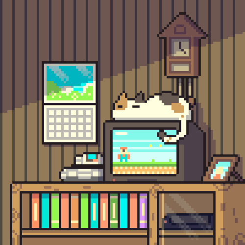

  

<h1 align="center">Hi, I'm Midnight 👋</h1>

  物随心转，境由心生，有容乃大，命由己造！

  

---

### About Me

- Focused on front-end engineering, automation, and AI-powered products.
- I like building useful tools with clean interaction details.
- Currently exploring smarter workflow agents and practical web experiences.

### Tech Stack

  
  
  
  
  
  
  
  
  
  
  

### Contact Me

1. [BLOG](https://zyweb.vip)
2. [CSDN](https://blog.csdn.net/h_midnight)
3. WeChat: `midnight_exclusive`
